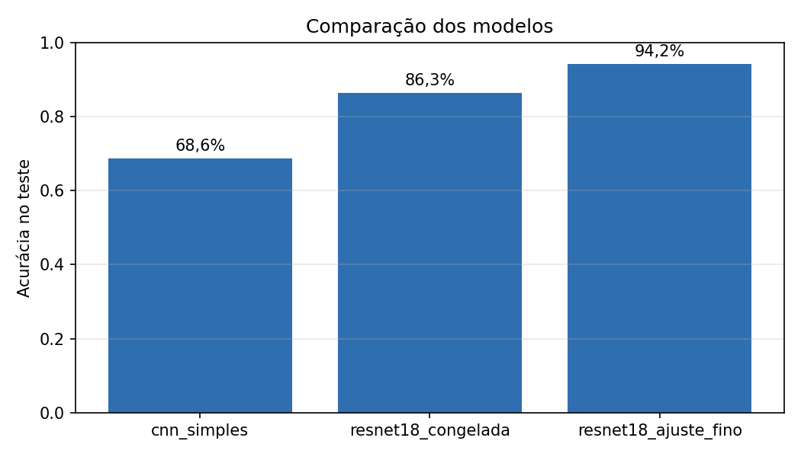

# Classificação de Pratos com PyTorch

[](https://github.com/CaueFAbreu/classificacao-pratos-pytorch/actions/workflows/ci.yml)

Classificação de imagens de 10 pratos comuns em pedidos de delivery a partir do dataset Food-101. O projeto compara uma CNN treinada do zero com duas formas de transfer learning da ResNet18 (base congelada e ajuste fino), sob o mesmo protocolo de avaliação.

> **Status:** concluído. Métricas por classe, curvas de treino e matrizes de confusão estão em [`reports/`](reports/).

## Stack

Python · PyTorch · torchvision · scikit-learn · matplotlib · pytest · Ruff · GitHub Actions · Google Colab

## Resultados

Os três modelos foram avaliados uma única vez no conjunto de teste oficial (2.500 imagens, 250 por classe), com o checkpoint de maior acurácia de validação. O treinamento foi executado em uma GPU NVIDIA T4 no Google Colab, com semente 42.

| Experimento | Parâmetros treináveis | Melhor época | Tempo de treino | Acurácia | F1 macro |
|---|---:|---:|---:|---:|---:|
| `cnn_simples` | 391.466 | 20 de 20 | 14,6 min | 68,6% | 0,681 |
| `resnet18_congelada` | 5.130 | 7 de 8 | 5,6 min | 86,3% | 0,863 |
| `resnet18_ajuste_fino` | 11.181.642 | 8 de 8 | 5,9 min | **94,2%** | **0,942** |



### Análise

- **Transfer learning:** o ajuste fino da ResNet18 obteve a maior acurácia, 25,6 p.p. acima da CNN treinada do zero e 7,9 p.p. acima da base congelada, com tempo de treino semelhante ao da base congelada.
- **CNN treinada do zero:** a acurácia de validação cresceu até a última época, o que indica que o desempenho foi limitado pelo número de épocas, e não por overfitting.
- **Base congelada:** a acurácia de validação se estabilizou entre 81% e 82% a partir da 4ª época, já que apenas a camada de classificação é ajustada sobre as representações fixas aprendidas no ImageNet.
- **Ajuste fino:** a acurácia de treino chegou a 98,8%, contra 90,6% na validação, e a perda de validação se manteve em torno de 0,31 a partir da 5ª época. Há sinal de overfitting, mas sem queda da acurácia de validação no período treinado ([curvas de treino](reports/resnet18_ajuste_fino/curvas.png)).
- **Teste acima da validação:** nos três modelos, a acurácia de teste superou a de validação em 3,6 a 4,4 p.p. A diferença é consistente com o ruído de rótulo do treino do Food-101, de onde a validação é extraída, enquanto o teste foi revisado manualmente.

### Confusões mais frequentes

Pares de classes mais confundidos no teste, somando os dois sentidos:

| Par de classes | CNN do zero | Base congelada | Ajuste fino |
|---|---:|---:|---:|
| Pizza e lasanha | 86 | 41 | 23 |
| Hambúrguer e cachorro-quente | 48 | 25 | 19 |
| Donut e sorvete | 57 | 15 | 5 |

Pizza e lasanha formam o par mais confundido em todos os modelos, possivelmente pela semelhança visual entre os pratos vistos de cima. A confusão entre donut e sorvete, frequente na CNN treinada do zero, cai de 57 para 5 casos com o ajuste fino ([matriz de confusão](reports/resnet18_ajuste_fino/matriz_confusao.png)).

### Limitações

- Cada experimento foi executado com uma única semente, portanto não há estimativa da variância entre execuções.
- Com 2.500 imagens de teste, o intervalo de confiança de 95% da acurácia varia de ±0,9 p.p. (ajuste fino) a ±1,8 p.p. (CNN do zero).
- O estudo usa 10 das 101 classes do Food-101, e os resultados não se estendem diretamente ao dataset completo.

## Dados

- **Fonte:** [Food-101](https://data.vision.ee.ethz.ch/cvl/datasets_extra/food-101/) (Bossard et al., 2014), baixado automaticamente pelo `torchvision`.
- **Classes (10):** asinha de frango, donut, batata frita, arroz frito, hambúrguer, cachorro-quente, sorvete, lasanha, pizza e sushi.
- **Partições:** 750 imagens de treino e 250 de teste por classe, conforme a divisão oficial do dataset. 15% do treino é separado, de forma estratificada, para validação.

| Partição | Imagens | Uso |
|---|---:|---|
| Treino | 6.375 | Ajuste dos pesos |
| Validação | 1.125 | Escolha da melhor época |
| Teste | 2.500 | Avaliação final, usada uma única vez |

Segundo os autores, as imagens de treino do Food-101 contêm algum ruído de rótulo, e as de teste foram revisadas manualmente.

## Metodologia

| Experimento | Modelo | Parâmetros treinados | Épocas | Taxa de aprendizado |
|---|---|---|---:|---:|
| `cnn_simples` | CNN de 4 blocos convolucionais, treinada do zero | Todos | 20 | 1e-3 |
| `resnet18_congelada` | ResNet18 pré-treinada no ImageNet, base congelada | Somente a última camada | 8 | 1e-3 |
| `resnet18_ajuste_fino` | ResNet18 pré-treinada no ImageNet | Todos | 8 | 1e-4 |

Decisões comuns aos três experimentos:

- **Aumento de dados apenas no treino:** recorte aleatório, espelhamento horizontal e variação de cor. Validação e teste usam um recorte central fixo, para que a avaliação não dependa de sorteio.
- **Normalização com as estatísticas do ImageNet,** exigida pelos pesos pré-treinados.
- **Otimização:** AdamW com decaimento de peso de 1e-4, agenda de taxa de aprendizado em cosseno e precisão mista na GPU.
- **Seleção do modelo pela validação:** o checkpoint da época com maior acurácia de validação é o único avaliado no teste.
- **Reprodutibilidade:** semente fixa para a divisão dos dados, a ordem dos lotes e a inicialização dos pesos.
- **Métricas:** acurácia, F1 macro, precisão e recall por classe, matriz de confusão e os pares de classes mais confundidos.

## Como reproduzir

### No Google Colab (GPU)

Abra [`notebooks/treinamento_colab.ipynb`](notebooks/treinamento_colab.ipynb) no Colab, selecione uma GPU e execute todas as células. O notebook baixa o dataset, treina os três modelos e gera os relatórios.

### Localmente

Pré-requisitos: Python 3.13 e Git. O treino em CPU é possível, mas lento.

```bash
git clone https://github.com/CaueFAbreu/classificacao-pratos-pytorch.git
cd classificacao-pratos-pytorch
python -m venv .venv
```

Ative o ambiente virtual:

```powershell
# Windows (PowerShell)
.\.venv\Scripts\Activate.ps1
```

```bash
# Linux / macOS
source .venv/bin/activate
```

Instale as dependências:

```bash
python -m pip install -r requirements-dev.txt
```

`requirements.txt` contém apenas as dependências de execução; `requirements-dev.txt` acrescenta as de teste e lint.

```bash
python -m src.dados --dados data                                  # baixa o Food-101 (~5 GB)
python -m src.treino --modelo resnet18_ajuste_fino --dados data   # treina e avalia um modelo
python -m src.relatorio                                           # gera a tabela comparativa
```

## Verificações

Os testes usam um Food-101 falso e pequeno, gerado na hora, e rodam em CPU em poucos segundos. São os mesmos comandos executados pela integração contínua:

```bash
ruff check .
ruff format --check .
pytest
```

## Estrutura

| Caminho | Conteúdo |
|---|---|
| `src/config.py` | Classes, hiperparâmetros e configuração dos experimentos |
| `src/dados.py` | Download, seleção das classes, divisão e DataLoaders |
| `src/modelos.py` | CNN simples e variações da ResNet18 |
| `src/treino.py` | Laço de treino, escolha do checkpoint e avaliação no teste |
| `src/avaliacao.py` | Métricas e gráficos |
| `src/relatorio.py` | Tabela e gráfico comparativos |
| `tests/` | Testes de dados, modelos e do pipeline completo |
| `notebooks/` | Execução no Google Colab |
| `reports/` | Métricas, curvas de treino e matrizes de confusão |

## Referência

Bossard, L., Guillaumin, M. e Van Gool, L. *Food-101: Mining Discriminative Components with Random Forests.* European Conference on Computer Vision (ECCV), 2014.
